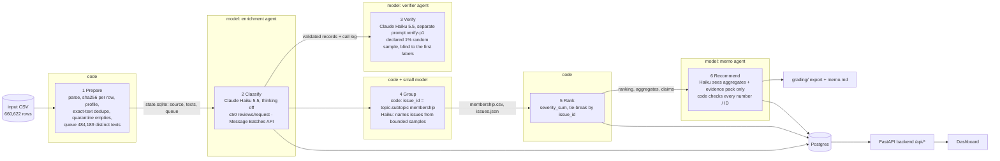

# Spotify review pipeline → product recommendation with traceable evidence

Multi-agent, code-orchestrated pipeline that turns all **660,622** Spotify Google Play reviews
(May 2022 – Nov 2023, 97.4 MB) into a ranked list of product issues and a recommendation on where the
next quarter of product effort should go: access, usability, playback, or billing/support.

* **Live dashboard:** **https://spotify-review-insights-gwok.onrender.com** — no login. The free host sleeps when idle, so the first load can take about 50 s.
* **Results, generated from saved outputs:** [docs/RESULTS.md](docs/RESULTS.md) · **Memo:** [runs/full/memo.md](runs/full/memo.md)
* **Grading export:** [runs/full/grading/](runs/full/grading/) · **Cost calculator:** [cost/report.md](cost/report.md)
* **Labels and schema:** [docs/LABELS.md](docs/LABELS.md) · **Prompts:** [pipeline/prompts/](pipeline/prompts/)

> Everything a grader needs can be inspected and recomputed **without an API key**. See *Check it without paying* below.

---

## Rubric → evidence

| Rubric item | Where to look |
|---|---|
| **Deliverable 1:** accessible code, setup and artifacts | This README · `requirements.txt` · `.env.example` · `data/README.md` · release asset with `enriched.jsonl.gz` + `state.sqlite` |
| **Deliverable 2:** architecture, shared schema, provenance | [Architecture](#architecture) · [docs/LABELS.md](docs/LABELS.md) · `runs/full/data_manifest.json` (input sha256, code version, prompt hashes, output hashes) · `label_config` on every record and call |
| **Deliverable 3:** memo numbers linked to calculations and evidence | `runs/full/memo.md` cites claim IDs · `runs/full/claims.csv` / `claims_all.csv` · `memo_validation.json` (code check of every number, issue ID and review ID) · checker `claim_mismatch` = 0 |
| **Deliverable 4:** recommendation, alternatives, limitations | `runs/full/memo.md` · dashboard "AI-generated recommendation" |
| **Testing 1:** 50 human labels, per-field comparison, error analysis | `evals/golden_labels.csv` (hand-labeled with `evals/label_tool.html`) · `evals/golden_report.md` · `golden_cases.csv` · `golden_results.json` |
| **Testing 2:** independent verification, planted errors, injection | `runs/full/verification_report.json` + `verify_disagreements.csv` · `evals/system_tests_report.md` (planted-error test, injection test, malformed output, transient failures, spend cap, resume) |
| **Testing 3:** 100-review cold/warm pilot, calculator, controls | `cost/report.md`, `pilot_calls.jsonl`, `pilot_records.jsonl`, `usage.csv`, `rates.csv`, `assumptions.json`, `checkpoints.json` · `python cost/calculator.py` (offline) |
| **Working 1:** full ingestion, coverage, classification | `runs/full/ingestion_report.json` · `grading/ingestion.json` · `grading/records.jsonl.gz` · checker report in docs/RESULTS.md |
| **Working 2:** staged program, bounded calls, saved handoffs, resume | `python -m pipeline run --input <csv>` · ≤ 50 reviews per request · `grading/checkpoint_before.json` / `checkpoint_after.json` · [`docs/resume_recording.mp4`](docs/resume_recording.mp4) · session table in RESULTS.md |
| **Working 3:** reproducible ranking and deployed dashboard | `python -m pipeline rerank --grading runs/full/grading --check` · dashboard (FastAPI backend → Postgres) |

## Results summary

All numbers are generated into [docs/RESULTS.md](docs/RESULTS.md) by `python -m pipeline report --run full`, so they
always match the saved files. Measured values are kept apart from estimates there.

| measure | result (full run `runs/full`, measured) |
|---|---|
| Source rows accounted for | **660,622 / 660,622**: 660,602 completed + 20 quarantined (13 `empty_review_text`, 7 `invalid_model_output_after_retry_and_fallback`) |
| Completed classifications of nonempty reviews | 660,602 / 660,609 (99.9989%) |
| Distinct texts sent to the model / exact-text cache reuses | 484,189 / 176,420 rows |
| Enrichment requests | 9,835 (8 failed, all retried); 86 texts completed by the capped Haiku-with-thinking fallback (cap 0.1%) |
| API spend, full run | **$9.74** (enrich $9.56, verify $0.18, group + memo < $0.01) = **$1.47 per 100k rows** (course cap $10). Projection before the run: $11.73 base / $15.81 conservative ([calculator](cost/report.md)); actual came in under base. Whole assignment including pilot, checkpoints, golden and tests: about $10. |
| Wall-clock | enrichment 6,344 s in the final resumed session (Message Batches); end-to-end stage times in `runs/full/run_log.jsonl` |
| Interruption → resume | checkpoint_before 81,711 completed IDs → checkpoint_after 660,602; 0 completed IDs resent |
| Independent verifier (declared 1% sample, n = 4,823) | topic 0.852 · intent 0.932 · severity exact 0.870 (MAE 0.133) · 1,372 disagreements listed |
| Golden 50 vs human labels | dedicated run: topic 0.50 · intent 0.82 · severity 0.60 (MAE 0.60) · sentiment ±0.5 0.98 · quotes exact 1.00 ([error analysis](evals/golden_report.md)). **Submitted full-run predictions:** topic 0.48 · intent 0.84 · severity 0.62 (MAE 0.52) · sentiment 1.00 ([report + run-to-run variability](evals/golden_full_run/golden_report.md)) |
| System tests | injection 7/7, planted errors 20/20 caught, spend cap never exceeded, resume resent 0 ([report](evals/system_tests_report.md)) |
| 100-review pilot | cold $0.0071 / 480 s; warm $0 / 0 enrichment calls ([cost/report.md](cost/report.md)) |
| Recommendation | **billing/support**: `billing.premium_paywall` 41,553 complaints, severity sum 115,758; billing has the most cancellation-intent records (9,552) ([memo](runs/full/memo.md)) |

**Self-check (`tools/check_submission.py`) on `runs/full/grading`.** Coverage candidate 1.0, 0 missing, 0 duplicate or
invalid rows, 176,420 valid cache reuses, ranking and claims recomputed with no mismatch. It reports two expected items:
`unfinished_classification: 7` (the 7 nonempty reviews quarantined after retry and fallback) and
`call_config_mismatch: 108`. The second covers 54 reviews: each was sent in a primary-config request that returned
invalid output for that review, then completed by the declared fallback config (`…+effort-medium+…`), so the earlier
request lists the ID under a different `label_config`. The fallback's own successful calls are logged with the matching config.

**Disclosed correction.** The first batch session after the interruption was tagged `resume` by an older phase rule
while no results had yet been saved, which also wrote an empty checkpoint. Following the documented rule ("resume only
after saved completed work"), its phase tag was corrected to `initial` and the empty checkpoint was removed. No
calls, usage, costs or labels changed. The correction is logged in `runs/full/run_log.jsonl` (`phase_label_correction`).

---

## Interruption / resume recording

[docs/resume_recording.mp4](docs/resume_recording.mp4) (2 min 40 s): three terminal recordings joined end to end, unedited apart from compression.

| time | what it shows |
|---|---|
| 0:00–1:18 | Ends the golden-set evaluation, then starts the full run. `ingest` reads all 660,622 rows (660,609 nonempty, 484,189 distinct texts, 13 empty → quarantine, 0 duplicate IDs, 159,701 missing app_version) in 18.5 s. `enrich` submits and saves 4 Message Batch jobs (1,600 requests of at most 50 reviews, about $0.70 reserved each), then Ctrl-C stops the process. Jobs keep running at the provider. |
| 1:18–2:12 | `enrich --run full --stop-after-batches 1` restarts. The screen shows "RESUME detected … 0 completed IDs": this is the older phase rule tagging a restart with nothing saved yet as a resume. It was corrected afterwards and is disclosed in "Disclosed correction" above and in `run_log.jsonl`. |
| 2:12–2:40 | The first 3 jobs are collected and saved (59,903 distinct texts = 81,711 rows, $1.21), and the session stops (the interruption). `status` shows the saved progress. `run --run full` then prints **"RESUME detected: saved checkpoint_before with 81,711 completed IDs; 1 job(s) to collect"**, collects the 4th job without resubmitting it, and submits new jobs only for pending texts. |

The first session (11:04 pm) was stopped with Ctrl-C before any job finished, so its session summary is empty in `run_log`; no results or calls were lost, and its 4 jobs were collected later.

`grading/checkpoint_before.json` (81,711 IDs) and `checkpoint_after.json` (660,602 IDs) are the snapshots on either side of this resume. Resume-phase calls contain none of the checkpoint_before IDs, which `tools/check_submission.py` verifies.

## Architecture



**Who decides what.** Code owns record accounting, hashing, deduplication, the queue, batching,
validation, retries, budgets, membership, arithmetic, ranking and the export. Models are used only where
language judgment is needed:

| Role | Model / settings | Input | Output | Why a model is needed / what code does instead |
|---|---|---|---|---|
| Enrichment agent | `claude-haiku-5-5`, thinking disabled, effort low, Message Batches API (50% price), prompt `enrich-p2`, schema `schema-s2` | ≤ 50 distinct review texts with short keys (r01..r50); no stars or IDs | topic.subtopic, intent, severity, sentiment, exact quote, flag | Reading messy multilingual text. Code validates keys, enums, ranges and quote membership, extracts entities with a lexicon, and copies results to exact duplicates. |
| Fallback | `claude-haiku-5-5` with adaptive thinking (effort medium), single review, capped at 0.1% of texts | 1 review that failed validation twice | same schema | Hard cases only. After the fallback, code quarantines the review with its reason. |
| Verifier agent | **Used in this run:** `claude-haiku-5-5` with its own prompt `verify-p1` and schema (topic, intent, severity only), 20 reviews per request, never shown the enricher's labels. Jev Choice ×3 is implemented (`pipeline/verify.py`) but was not used: no TypeSafe key was available. | review texts + rubric only | topic, intent, severity | Gives an independent second opinion from a different model family. Code computes agreement and lists every disagreement. |
| Issue-naming agent | `claude-haiku-5-5` (`group-p1`) | ≤ 12 issues × 8 sample quotes | title, description, example IDs | Writes human-readable names. Membership is fixed by code; foreign IDs and new issues are rejected. |
| Memo agent | `claude-haiku-5-5`, effort medium (`memo-p1`) | claims table, topic rollup, coverage, evidence pack | JSON memo | Builds the argument. Code rejects any number not in the claims, unknown issue IDs and review IDs outside the pack, with one retry. |

**Stop and retry paths.** Invalid output → re-queued once in a small batch → capped fallback →
`quarantined` with reason and attempt count. 429/5xx/timeouts → bounded exponential backoff with jitter;
not counted as invalid; five consecutive transport failures stop the session. Errored or expired batch
requests are re-queued, since they are not billed. Spend admission: a request is admitted only if
`spent + reserved in-flight + next worst-case reservation ≤ budget`, where the budget defaults to
**$10 per 100k input rows**. A time cap applies too. Ctrl-C drains in-flight work in sync mode; in batch mode,
submitted jobs keep running at the provider and are collected on resume. Nothing is paid twice.

**Caching (three separate mechanisms).** (1) The exact-text result cache is keyed by `sha256(text) + label_config`:
660,609 nonempty rows become 484,189 model inputs, and each duplicate row keeps its own ID with
`cache_source_id` pointing at the original. (2) Provider prompt caching marks the fixed system prompt with
`cache_control`. (3) Downstream caches: verifier labels, issue names and the memo are keyed by input hash, so a
warm rerun makes zero calls.

**Batching and queues.** CSV is streamed in one pass. Requests hold ≤ 50 reviews and ≤ 14,000 characters.
Jobs of 400 requests go to the Message Batches API, with at most 4 jobs in flight. Queue state lives in
SQLite and is committed atomically after every request's results, so there is a single writer and no
double counting.

## Data source

Course extract of BwandoWando, *3.4 Million Spotify Google Store Reviews*, Kaggle v2 (CC0), 2022-05-17 to 2023-11-17:
[course dataset ZIP](https://drive.google.com/file/d/1P0rUoAS_wVjp3BYKqXMEyD4u0uJP1Bvf/view) ·
[Kaggle source](https://www.kaggle.com/datasets/bwandowando/3-4-million-spotify-google-store-reviews).
`spotify_reviews_18months.csv`: 97,400,616 bytes, 660,622 rows, sha256
`1fc85de68a304dd8978b537cfa58793d5f41cbaf417fa32cb53899f83a2fcef6` (verified at ingestion; see `runs/full/ingestion_report.json`).
It is not committed; place it at `data/spotify_reviews_18months.csv` (see [data/README.md](data/README.md)).

## Setup

```sh
python3 -m venv .venv && source .venv/bin/activate      # Python 3.10+
pip install -r requirements.txt
cp .env.example .env     # fill ANTHROPIC_API_KEY (+ DATABASE_URL for the dashboard; TYPESAFE_API_KEY only if using the optional Jev verifier)
# put the 97.4 MB CSV at data/spotify_reviews_18months.csv (see data/README.md)
```

`.env` is git-ignored (`git check-ignore .env` prints `.env`); only the blank `.env.example` is tracked.

## Run order (commands used for this submission)

```sh
# 0. free offline checks (no key)
python evals/system_tests.py offline
python cost/calculator.py                                      # offline replay of the saved pilot

# 1. measured 100-review pilot: cold then warm, 1 worker, empty cache  (PAID, ~1 cent)
python cost/calculator.py pilot --confirm-paid

# 2. development checkpoints, then refresh the estimate  (PAID, cents)
python -m pipeline run --input data/checkpoint_500.csv  --run ckpt500  --skip memo
python cost/calculator.py refresh --run runs/ckpt500 --label checkpoint_500
python -m pipeline run --input data/analysis_10000.csv --run ckpt10k --skip memo
python cost/calculator.py refresh --run runs/ckpt10k --label analysis_10000 && python cost/calculator.py

# 3. golden set: label evals/label_tool.html by hand -> evals/golden_labels.csv, then
python -m pipeline run --input data/golden_50_to_label.csv --run golden50 --skip verify,memo
python evals/golden_eval.py --run runs/golden50

# 4. FULL RUN with a recorded interruption + resume (PAID, about $8-12)
python -m pipeline ingest --input data/spotify_reviews_18months.csv --run full
python -m pipeline enrich --run full --stop-after-batches 1      # collect 1 job, then stop (= interruption)
python -m pipeline status --run full                             # saved progress
python -m pipeline run --input data/spotify_reviews_18months.csv --run full   # resume + all later stages
python evals/system_tests.py offline --run runs/full             # adds the planted-error test on the real sample
python evals/system_tests.py injection --confirm-paid            # injection / hard cases (separate run)
python -m pipeline report --run full

# 5. self-check and dashboard
python tools/check_submission.py reference --full data/spotify_reviews_18months.csv --analysis data/spotify_reviews_18months.csv --out local-reference.json
python tools/check_submission.py check --reference local-reference.json --submission runs/full/grading --out self-check.json
python backend/load_db.py --run runs/full                        # loads Postgres (DATABASE_URL)
```

`python -m pipeline run --input ANY.csv --run ID` runs all six stages on an arbitrary CSV with the six source
columns. `--provider mock` is a free offline dry run, and its labels are refused by `export`.

## Check it without paying

```sh
python -m pipeline rerank --grading runs/full/grading --check   # ranking from records + membership, no model
python cost/calculator.py                                       # cost arithmetic from saved usage x rates.csv
python cost/calculator.py --rate-multiplier 2                   # API $ doubles; measured time unchanged
python evals/golden_eval.py --run runs/full                     # needs the release-asset enriched.jsonl.gz
python tools/check_submission.py check ...                      # as above
```

## Dashboard (deployed)

* **Database:** Supabase Postgres (free tier). `backend/schema.sql` creates `reviews` (all 660,622 rows with labels,
  quotes, verifier labels, original text), `issues`, `topics`, `monthly`, `claims` and `docs` (memo, run summary, evals,
  cost). It is loaded by `backend/load_db.py` from saved outputs.
* **Backend:** FastAPI (`backend/app.py`) on Render (`render.yaml`). It only reads from Postgres and never calls a
  model. Endpoints include `/api/overview`, `/api/ranking`, `/api/recommendation`, `/api/issues/{id}`,
  `/api/reviews?…`, `/api/reviews/{id}` (full trace) and `/api/evals`.
* **Frontend:** `backend/static/index.html`, served by the same service. It shows overall metrics, the AI
  recommendation with hoverable claim IDs, the issue ranking, topic and monthly views, an evidence explorer and a
  per-review trace (source → enrichment → verification → issue → rank → memo claim).

Deploy: create a Supabase project and copy its connection string into `DATABASE_URL` → `python backend/load_db.py --run runs/full` →
on Render choose New → Blueprint → this repo → set `DATABASE_URL` → open the URL.

## Scope, limitations and honest accounting

* The data is a self-selected, historical sample of public app reviews. It contains no revenue, plan tier or observed
  churn. Cancellation language is *expressed intent*. Stars are metadata only and are never sent to the model.
* Coverage counts rows that are *accounted for* (completed + quarantined) separately from *completed
  classifications*. Quarantined and pending rows are excluded from all aggregates.
* Ranking uses one issue per complaint (`allow_multi_issue: false`), so a review mentioning two problems counts
  once, under its most severe problem.
* Verification and golden agreement are diagnostics on small samples, not population accuracy.
* July and October 2023 have about 3× normal review volume. The trend view therefore uses complaints per 100
  completed reviews, with denominators shown. The first and last months are partial.
* The verifier is the same model family as the enricher, with a separate prompt, schema and blind input. Correlated errors
  can therefore inflate verifier agreement (0.85 topic). The human golden set (topic 0.48–0.50) is the more independent check,
  and the gap between the two is itself a finding.
* Run-to-run variability: 9 of the 50 golden reviews got different labels in two runs with identical settings, all
  borderline, political, non-English or mixed-issue texts ([details](evals/golden_full_run/golden_report.md)).
* Synthetic test reviews live only in `runs/evals-injection` and `runs/_systemtests`, never in business aggregates.

## Repository map

```
pipeline/            orchestrator + roles (ingest, enrich, batch_enrich, verify, group, rank, memo, export, report)
pipeline/prompts/    versioned role prompts
cost/                calculator, rates.csv, assumptions.json, pilot evidence, report.md
evals/               label tool, golden labels + eval, system tests, synthetic cases
backend/             FastAPI app, Postgres schema + loader, dashboard page
runs/full/           final run outputs (+ grading/ export); large files in the GitHub release
tools/check_submission.py   provided zero-API checker
docs/                LABELS.md, RESULTS.md (generated), resume recording
```
